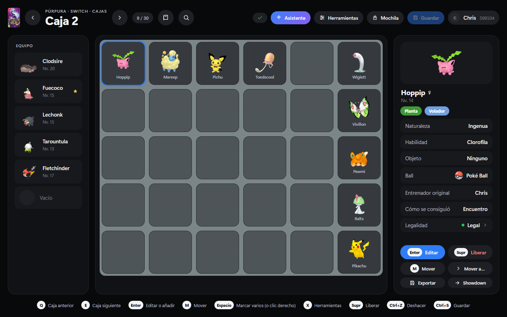
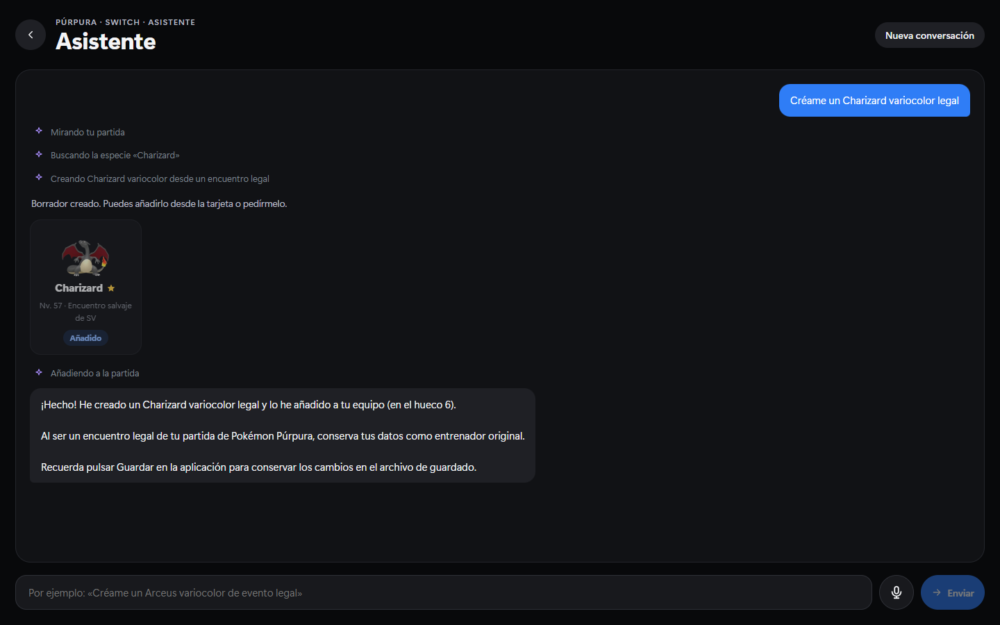
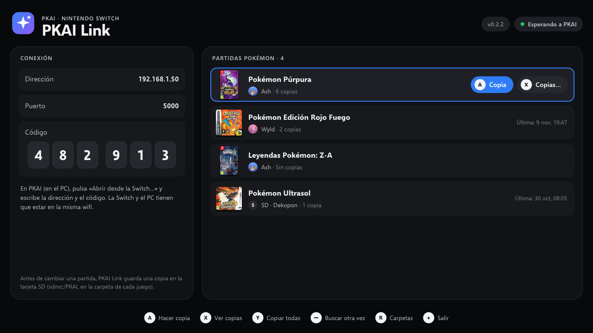

  

<h1 align="center">PKAI</h1>

  <b>Editor de partidas de Pokémon con asistente</b> 
  PC · Android · Nintendo Switch · Nintendo 3DS

  
  
  

  <a href="https://github.com/wyldts/pkai/releases/latest"><b>⬇️ Descargar la última versión</b></a>

  

PKAI abre partidas de Pokémon de **todas las generaciones**, de Rojo y Azul a Leyendas Z-A, y te deja editarlas sin miedo:
- enseña las cajas y el equipo;
- edita cualquier Pokémon y comprueba que es **legal** antes de guardar;
- guarda una copia de seguridad antes de tocar nada.

Y si prefieres pedirlo con tus palabras, tiene un **asistente**: «añade un Charizard variocolor legal», «¿qué Pokémon ilegales tengo?», «dame 99 caramelos raros».

---

## Dos programas que trabajan juntos

<table>
  <tr>
    <td width="50%" valign="top">
      <h3>🖥️ PKAI · PC y móvil</h3>
      
      
El editor. Abre la partida, edita Pokémon, la mochila y el entrenador, revisa la legalidad y usa el asistente. Para <b>Windows</b> y <b>Android</b>.

      
<a href="docs/PKAI.md"><b>Cómo se usa PKAI →</b></a>

    </td>
    <td width="50%" valign="top">
      <h3>🎮 PKAI Link · Switch y 3DS</h3>
      
      
El programa de la consola. Conecta la <b>Switch</b> o la <b>3DS</b> con PKAI por wifi: abres, editas y devuelves tus partidas sin sacar la tarjeta SD, con copias de seguridad.

      
<a href="docs/PKAI-Link.md"><b>Cómo se usa PKAI Link →</b></a>

    </td>
  </tr>
</table>

---

## Descargar

Todo está en **[la última versión](https://github.com/wyldts/pkai/releases/latest)**:

| Archivo | Para | Cómo se instala |
|---|---|---|
| `PKAI-PC-<versión>-Instalador.exe` | Windows 10 y 11 | Ábrelo y pulsa «Instalar». No hace falta ser administrador. |
| `PKAI-Movil-<versión>.apk` | Android | Ábrelo en el móvil. Android pide permiso para instalar apps de fuera de la Play Store. |
| `PKAI-Link-Switch-<versión>.nro` | Switch con homebrew | Cópialo a la SD como `switch/pkai-link.nro`. |
| `PKAI-Link-3DS-<versión>.3dsx` | 3DS con homebrew | Cópialo a la SD como `3ds/pkai-link.3dsx`. |

## Actualizaciones

- **PC y móvil:** cuando hay una versión nueva, el inicio de PKAI enseña el botón **Actualizar**. Se descarga y se instala dentro de la app, sin perder nada; en el PC, PKAI se cierra y se vuelve a abrir sola.
- **PKAI Link:** al conectar la consola, PKAI te ofrece la versión nueva y se la envía. La Switch se vuelve a abrir sola; en la 3DS, ciérralo y vuelve a abrirlo.

## Antes de empezar

- Haz una copia de tus partidas antes de editarlas por primera vez.
- No uses Pokémon modificados en combates ni intercambios con quien no sepa que lo están.
- Usar homebrew en la consola puede hacer que Nintendo la vete en línea.

---

## Créditos

**PKAI está creado por Wyld.**

Se basa en [PKHeX](https://github.com/kwsch/PKHeX), de Kaphotics y colaboradores, y se distribuye con la misma licencia, [GPL-3.0 o posterior](https://www.gnu.org/licenses/gpl-3.0.html), sin ninguna garantía.

PKAI no está afiliado con Nintendo, Game Freak, Creatures ni The Pokémon Company. Pokémon y sus nombres son marcas de sus respectivos dueños.
