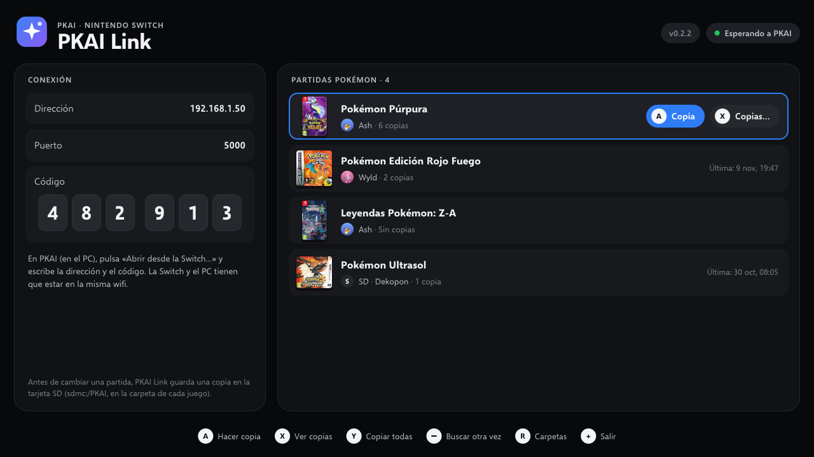
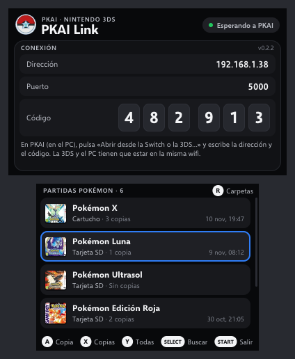
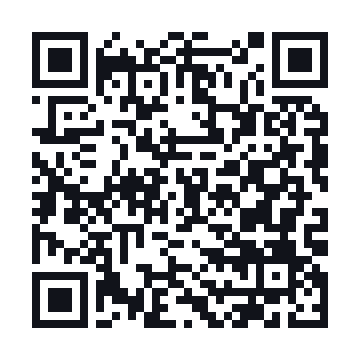
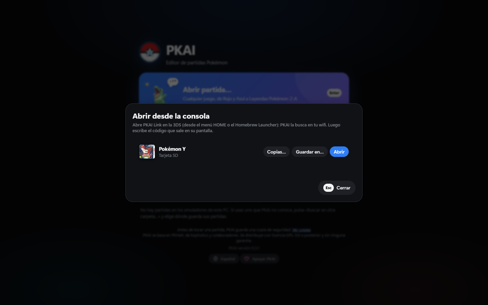
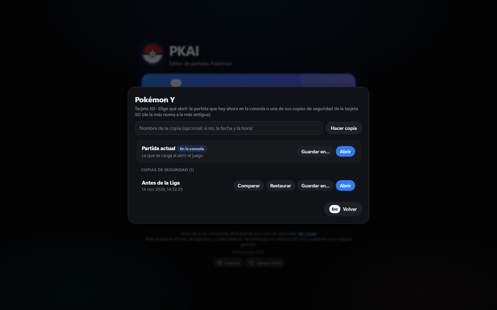
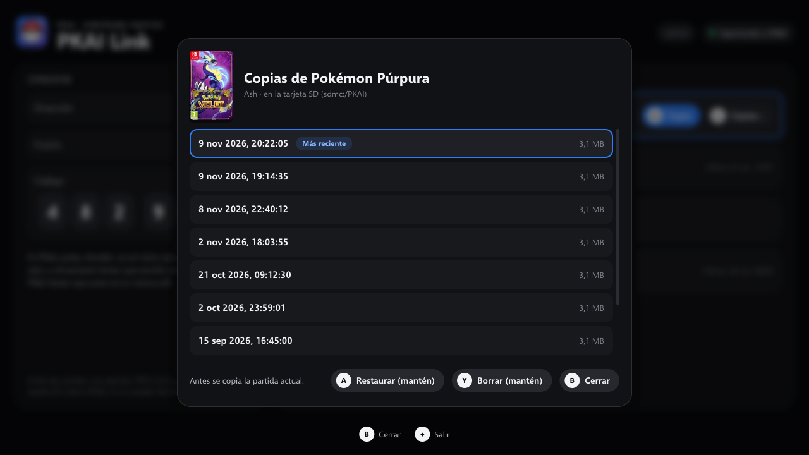
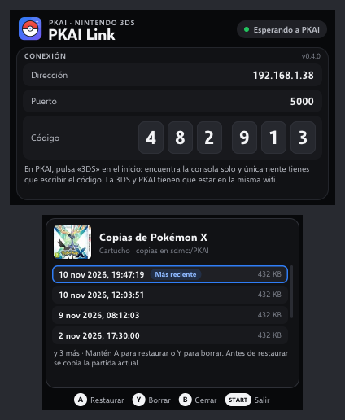
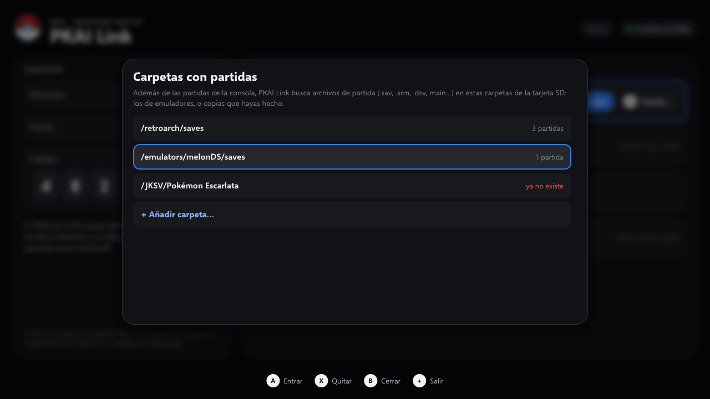

<p align="center">
  
</p>

<h1 align="center">PKAI Link · Switch y 3DS</h1>

<p align="center">
  El programa de la consola: conecta tu <b>Nintendo Switch</b> o tu <b>Nintendo 3DS</b> con PKAI por wifi.<br>
  <a href="../README.md">← Volver al inicio</a> · <a href="PKAI.md">PKAI (PC y móvil) →</a>
</p>

---

<table>
  <tr>
    <td width="62%"><br><sub>PKAI Link en la Switch: los datos para conectar y tus partidas, con su carátula y sus copias.</sub></td>
    <td width="38%"><br><sub>En la 3DS: arriba los datos para conectar, abajo las partidas.</sub></td>
  </tr>
</table>

## Qué hace

- 🔗 **Abres en PKAI las partidas de la consola por wifi**, las editas y las devuelves. Sin sacar la tarjeta SD, sin JKSV ni Checkpoint.
- 💾 **Antes de cambiar una partida, guarda una copia completa** en la tarjeta SD. También haces copias cuando quieras, **con nombre** («Antes de la Liga»).
- ✅ **Solo confirma el cambio si la partida ha llegado entera.** Si algo falla a mitad, la partida se queda como estaba.
- 🕹️ **Partidas sueltas de la SD:** las de emuladores (RetroArch, melonDS, mGBA…) o copias de JKSV y Checkpoint, en las carpetas que elijas.
- 🧩 **En la Switch, las partidas de los emuladores de 3DS** Dekopon y Raikopon, sin configurar nada.
- 🔄 **Se actualiza desde PKAI.**

### Juegos

| Consola | Juegos |
|---|---|
| **Switch** | Let's Go, Pikachu y Eevee · Espada y Escudo · Diamante Brillante y Perla Reluciente · Leyendas Arceus · Escarlata y Púrpura · Leyendas Z-A · Rojo Fuego y Verde Hoja (Switch) |
| **3DS** | X e Y · Rubí Omega y Zafiro Alfa · Sol y Luna · Ultrasol y Ultraluna (cartucho o descargados) · Rojo, Azul, Amarilla, Oro, Plata y Cristal de la consola virtual · Rubí, Zafiro, Esmeralda, Rojo Fuego y Verde Hoja de GBA (inyectados) |

Los juegos de DS no se pueden leer desde PKAI Link.

## Qué necesitas

- **Switch** con firmware personalizado (Atmosphère). Mejor con emuMMC y sin conectarte a los servidores de Nintendo con él.
- **3DS** con Luma3DS y el Homebrew Launcher.
- **PKAI** en el PC o en el móvil ([cómo instalarlo](PKAI.md#instalar)).
- La consola y el PC (o el móvil) **en la misma wifi**.

> ⚠️ Usar homebrew puede hacer que Nintendo vete la consola en línea. La primera vez, haz también una copia de tus partidas con JKSV o Checkpoint, por si acaso.

## Instalar

### Nintendo Switch
1. Descarga `PKAI-Link-Switch-<versión>.nro` de [la última versión](https://github.com/wyldts/pkai/releases/latest).
2. Cópialo a la tarjeta SD como `switch/pkai-link.nro`.
3. Ábrelo desde el menú de homebrew (mantén pulsado R al abrir cualquier juego; desde el Álbum también funciona).

### Nintendo 3DS: en el menú HOME (recomendado)

PKAI Link se instala como una aplicación más y sale en el menú HOME con su icono.

<table>
  <tr>
    <td width="180" align="center"></td>
    <td>
      <b>Con el código QR:</b> abre <b>FBI</b> → <b>Remote Install</b> → <b>Scan QR Code</b> y apunta la cámara a este código. FBI descarga e instala siempre la última versión.<br><br>
      <b>O desde la tarjeta SD:</b> copia <code>PKAI-Link-3DS-&lt;versión&gt;.cia</code> a la SD y, en FBI, <b>SD</b> → el archivo → <b>Install CIA</b>.
    </td>
  </tr>
</table>

Después, ábrelo desde el menú HOME.

### Nintendo 3DS: en el Homebrew Launcher
1. Descarga `PKAI-Link-3DS-<versión>.3dsx`.
2. Cópialo a la tarjeta SD como `3ds/pkai-link.3dsx`.
3. Ábrelo desde el Homebrew Launcher (tiene que abrirse desde ahí para poder actualizarse solo después).

## Conectar con PKAI

1. Abre PKAI Link en la consola. En su pantalla verás la **dirección**, el **puerto** y un **código** de 6 cifras.
2. En el inicio de PKAI (PC o móvil), pulsa **Switch** o **3DS**. PKAI encuentra la consola sola en tu wifi: elígela y pulsa **Conectar**. No hace falta escribir nada (para conectar, la consola y PKAI tienen que estar en la misma wifi y con PKAI Link abierto).
   * Con PKAI Link 0.3.2 o anterior, escribe también el código que sale en su pantalla; al conectar, PKAI te ofrece actualizarlo.
   * Si no la encuentra (por ejemplo, con PKAI Link 0.2.5 o anterior, o con algunas wifi de invitados), escribe tú la dirección y el código que salen en su pantalla.
3. Verás tus partidas. **Abrir** la trae a PKAI; **Copias…** enseña sus copias de seguridad; **Guardar en…** la copia a una carpeta de tu PC o de tu móvil (la de tu emulador, la de otro editor o la que quieras), con su nombre de siempre (`main`, `partida.sav`…). La partida de la consola no cambia, y si en esa carpeta ya había un archivo con el mismo nombre, se queda como `.anterior`.

<table>
  <tr>
    <td width="50%"><br><sub>Las partidas de la consola, vistas desde PKAI.</sub></td>
    <td width="50%"><br><sub>Abrir la partida actual o una copia, comparar, restaurar o guardarla en una carpeta.</sub></td>
  </tr>
</table>

## Editar y devolver una partida

1. **Abrir** la partida en PKAI y editarla como cualquier otra.
2. Cierra el juego en la consola (en la Switch: botón HOME y luego X).
3. En la pantalla de cajas, pulsa **Enviar a la Switch** (o **a la 3DS**).
4. PKAI enseña **qué va a cambiar** en la consola (dinero, Pokémon nuevos, cambiados, movidos, objetos…) y pide confirmación.
5. PKAI Link guarda una copia de la partida que había, escribe la nueva y PKAI comprueba que ha llegado idéntica. Ya puedes abrir el juego.

### Enviar una partida del PC o del móvil

También puedes llevar a la consola una partida que no abriste desde ella (de tu PC, de tu móvil, de un emulador…):

1. Ábrela en PKAI y pulsa **Enviar a la consola** en la pantalla de cajas (o en **Herramientas**).
2. Conecta con PKAI Link y elige **qué partida de la consola sustituye** (tiene que ser del mismo juego).
3. Como siempre, PKAI enseña qué va a cambiar (y te avisa si es de otro entrenador) y la consola guarda una copia de la suya antes de sustituirla.

## Copias de seguridad

Se guardan en la tarjeta SD, una carpeta por juego y, dentro, una por copia:

```
sdmc:/PKAI/
  Pokémon Escarlata/
    Ash - 2026-11-12 10-15-00 - Antes de la Liga/
      main
    Ash - 2026-11-12 18-40-02/
      main
```

- En la Switch, cada copia lleva delante el **usuario** de la consola; en la 3DS, la del cartucho lleva «Cartucho - ».
- Detrás va la fecha y, si se lo pusiste, su nombre.
- Desde PKAI puedes **abrir** cualquier copia, **compararla** con la partida actual, **restaurarla** en la consola (antes se guarda una copia de la actual) o **guardarla** en una carpeta de tu PC o de tu móvil.

<table>
  <tr>
    <td width="62%"><br><sub>Las copias de una partida en la Switch (botón X).</sub></td>
    <td width="38%"><br><sub>Y en la 3DS.</sub></td>
  </tr>
</table>

## Partidas sueltas de la SD

Además de las de la consola, PKAI Link busca archivos de partida en las carpetas de la SD que elijas: emuladores, copias de JKSV o Checkpoint, o los que copies a mano. Salen en la lista como una partida más.

- Se eligen con **R → Carpetas**, con un explorador de la SD.
- Cuentan los `.sav`, `.srm`, `.dsv`, `.dat`, `.gci`, `.bin`… y los que se llaman `main`.

<p align="center"></p>

### Emuladores de 3DS en la Switch

PKAI Link de Switch encuentra solo las partidas de **Dekopon** (`sdmc:/switch/dekopon/`) y **Raikopon** (`sdmc:/switch/azahar/`):
- Salen con el nombre del juego, su carátula y el emulador debajo («SD · Dekopon»).
- Funcionan con X, Y, Rubí Omega, Zafiro Alfa, Sol, Luna, Ultrasol, Ultraluna y los de Game Boy de la consola virtual instalados en el emulador.
- Cierra el emulador antes de enviar una partida desde PKAI.

## Actualizar PKAI Link

Al conectar la consola, si hay una versión nueva, PKAI enseña **Actualizar PKAI Link**: la descarga de aquí y se la envía a la consola.
- La **Switch** se cierra y se vuelve a abrir sola con la versión nueva.
- En la **3DS**, pulsa START para salir y vuelve a abrirlo (desde el menú HOME o el Homebrew Launcher, según cómo lo instalaras). Instalado en el menú HOME, PKAI Link instala la versión nueva él mismo, como FBI.
- Las versiones anteriores a la 0.2.2 se actualizan una vez copiando el archivo a mano. En la **3DS**, también las anteriores a la 0.2.9: en una 3DS de verdad no podían recibir archivos (por eso salía «La consola no ha abierto la conexión de datos» al abrir una partida).

## Botones

| Switch | 3DS | Qué hace |
|---|---|---|
| Arriba / abajo | Arriba / abajo | Elegir partida |
| A | A | Hacer una copia (antes puedes ponerle nombre con el teclado) |
| X | X | Ver sus copias |
| Y | Y | Copiar todas las partidas Pokémon |
| R | R | Carpetas de la SD con partidas sueltas |
| − | SELECT | Buscar las partidas otra vez |
| + | START | Salir |

En la Switch también se puede tocar la pantalla, y en la 3DS la de abajo.

## Si no sale ninguna partida

Debajo de «No hay partidas…» PKAI Link dice qué ha visto y, si lo hay, el código de error. Lo más habitual:
- **El juego no ha guardado nunca:** juega y guarda una vez.
- **3DS abierta sin Luma3DS:** el sistema no le deja leer las partidas de otros juegos. Ábrelo desde el Homebrew Launcher con Luma3DS, como Checkpoint.
- **Un cartucho de DS:** sus partidas no se pueden leer.
- **Un juego abierto en la Switch:** ciérralo antes de enviar una partida.
