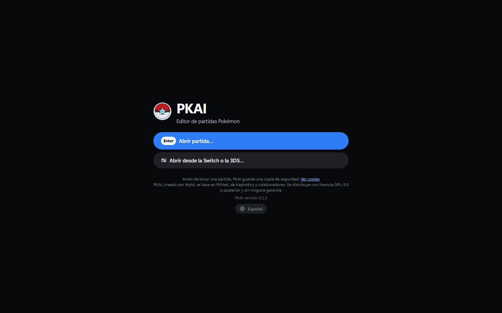
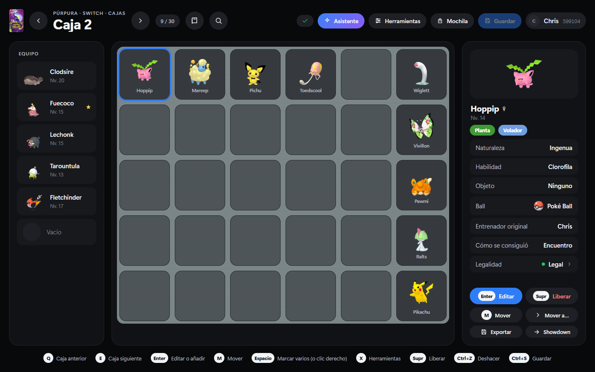
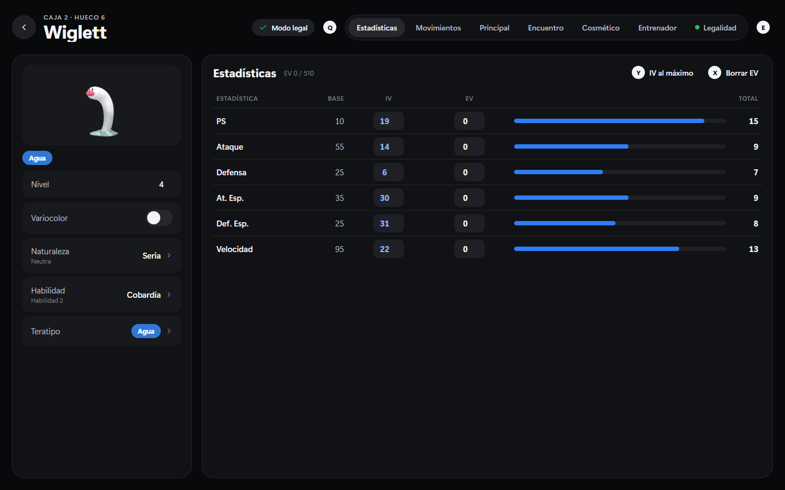
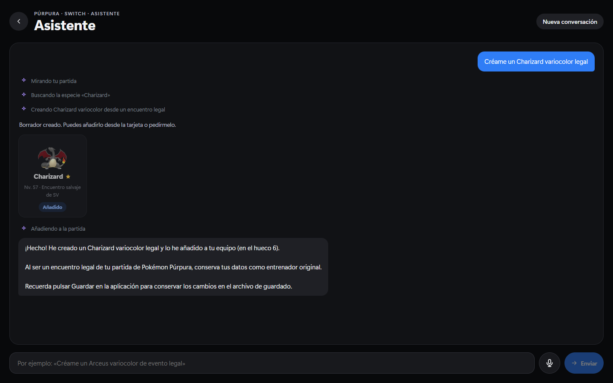
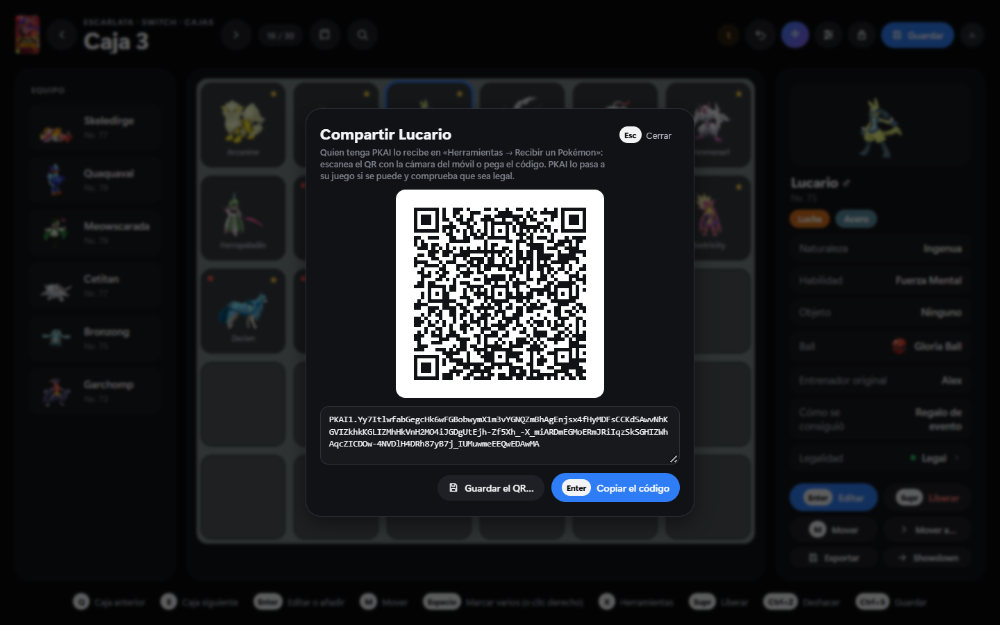
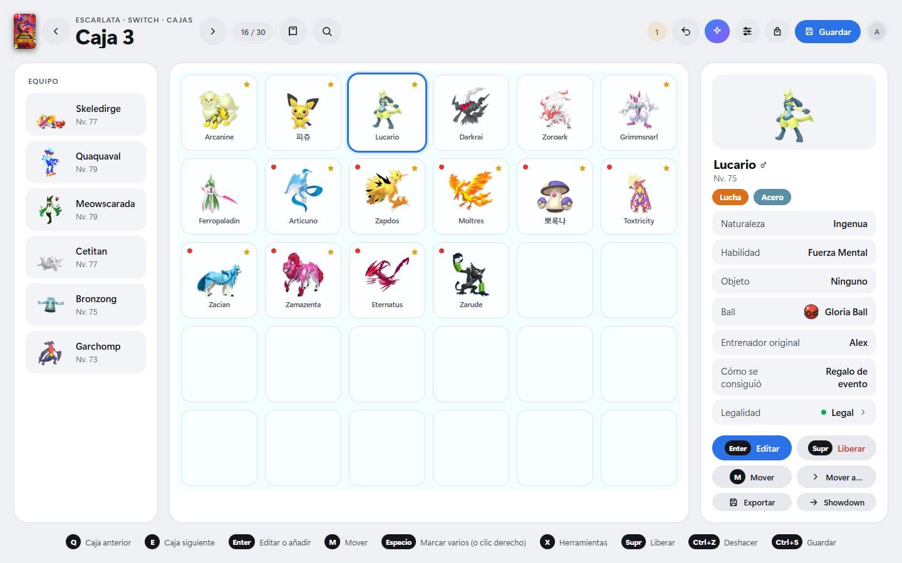
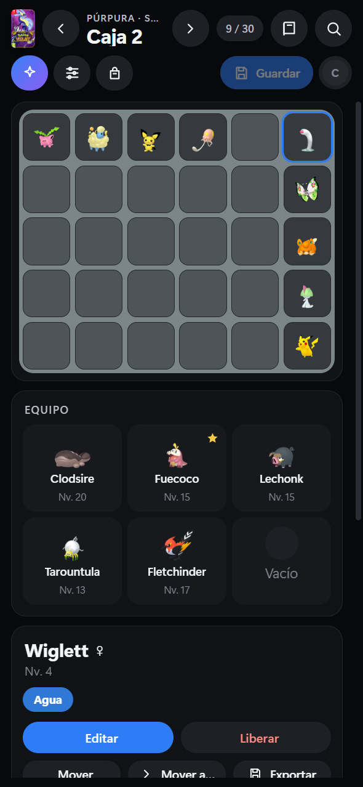
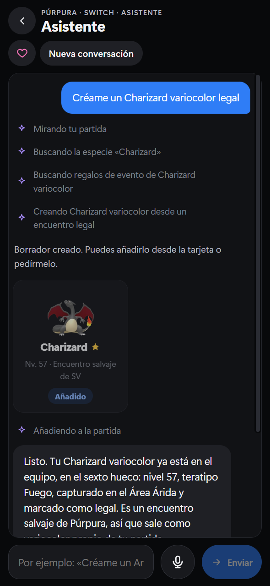

  

<h1 align="center">PKAI · PC y móvil</h1>

  El editor de partidas, para <b>Windows</b> y <b>Android</b>. 
  <a href="../README.md">← Volver al inicio</a> · <a href="PKAI-Link.md">PKAI Link (Switch y 3DS) →</a>

---

## Qué puedes hacer

- 📂 **Abrir partidas de todas las generaciones** (ver [la lista de juegos](#juegos-que-abre)). PKAI dice de qué juego y de qué consola es cada una.
- 📦 **Ver y ordenar las cajas y el equipo:** mover Pokémon arrastrándolos, marcar varios a la vez, buscar por especie, movimiento, tipo o variocolor, y ordenar por Pokédex, nivel o tipo.
- ✏️ **Editar cualquier Pokémon:** estadísticas, IV y EV, movimientos, naturaleza, habilidad, objeto, Ball, variocolor, teratipo, encuentro y entrenador.
- ✅ **Comprobar la legalidad** antes de guardar. Con el «Modo legal», PKAI no deja hacer cambios que lo volverían ilegal.
- 🎁 **Catálogo de eventos, intercambios y regalos** de todas las generaciones, sin conexión. Cada uno se convierte a tu partida y solo se ofrece si sale legal. Con **Añadir todos** pones de una vez todos los de tu búsqueda, seguidos y sin repetir los que ya tienes. **Se actualiza solo:** cuando salen eventos nuevos, PKAI los descarga al abrirse (de Project Pokémon), sin esperar a otra versión.
- 🎒 **Mochila, dinero, tiempo de juego, Pokédex y Living Dex:** rellena con Pokémon legales las especies que faltan, sus variocolores o **todas las formas** (las letras de Unown, los diseños de Vivillon, las formas regionales…).
- 🏅 **Progreso de la partida:** medallas, **volver a enfrentar legendarios** que ya capturaste o derrotaste, Pokémon errantes y guardería.
- 📤 **Compartir un Pokémon con un QR o un código:** quien lo recibe lo pega en su PKAI, que lo pasa a su juego si se puede y comprueba que sea legal.
- 🌗 **Tema oscuro, claro o automático** (el del sistema).
- 🧰 **Sin conexión, en Herramientas:** juntar los Pokémon sin huecos (sin tocar las cajas que elijas), cambiar muchos a la vez (nivel, amistad al máximo, quitar objetos o motes) y ver **dónde se consigue** cada especie en tu juego.
- 🔍 **Comparar dos versiones de una partida:** qué ha cambiado desde una copia de seguridad o desde que la abriste.
- 🤖 **El asistente:** le pides las cosas con tus palabras y las hace él (ver [El asistente](#el-asistente)).
- 🎮 **Partidas de la consola por wifi** con [PKAI Link](PKAI-Link.md).
- 🌍 En **español, inglés e italiano**, con los nombres oficiales de cada idioma.

## Capturas

<table>
  <tr>
    <td width="50%"> El inicio: abre una partida del equipo, de la Switch o de la 3DS.</td>
    <td width="50%"> Las cajas, el equipo y el Pokémon elegido, con su legalidad.</td>
  </tr>
  <tr>
    <td width="50%"> El editor: estadísticas, movimientos, encuentro, legalidad…</td>
    <td width="50%"> El asistente crea un Charizard variocolor legal y lo añade.</td>
  </tr>
</table>

<table>
  <tr>
    <td width="50%"> Compartir un Pokémon con un QR o un código.</td>
    <td width="50%"> El tema claro (en el inicio o en «Herramientas → Tema»).</td>
  </tr>
</table>

  
  &nbsp;&nbsp;
  
   PKAI Móvil: lo mismo, adaptado a la pantalla táctil.

## Instalar

### Windows

Hay dos versiones, con las mismas funciones. Elige la que prefieras:

**Con instalador**
1. Descarga `PKAI-PC-<versión>-Instalador.exe` de [la última versión](https://github.com/wyldts/pkai/releases/latest).
2. Ábrelo y pulsa **Instalar**. Se instala en tu usuario, sin ser administrador, con un acceso en el menú Inicio (y, si quieres, en el escritorio).
3. Para desinstalarlo: Configuración de Windows → Aplicaciones instaladas → PKAI.

**Portable (sin instalar)**
1. Descarga `PKAI-PC-<versión>-Portable.zip` de [la última versión](https://github.com/wyldts/pkai/releases/latest).
2. Descomprímelo donde quieras: en Documentos, en otra unidad o en un USB. Sale una carpeta `PKAI`.
3. Abre `PKAI.exe` de esa carpeta. No crea accesos directos ni toca el registro de Windows.
4. Todo lo suyo (partidas recientes, copias de seguridad y ajustes) se guarda en la carpeta `Datos`, junto al programa. Puedes mover la carpeta `PKAI` entera a otro sitio, y para quitarlo basta con borrarla.
5. Se actualiza igual que la otra, con **Actualizar**, y conserva la carpeta `Datos`. No borres el archivo `portable.txt`: es el que le dice que es la portable.

Las dos necesitan WebView2 de Microsoft, que ya viene con Windows 11. En Windows 10, el instalador avisa si falta; si usas la portable y PKAI no se abre, instálalo desde [la página de Microsoft](https://developer.microsoft.com/microsoft-edge/webview2/).

### Android
1. Descarga `PKAI-Movil-<versión>.apk` en el móvil.
2. Ábrelo. La primera vez, Android pide permiso para instalar apps de fuera de la Play Store: dáselo al navegador o a la app de archivos con la que lo abras.

## Cómo se usa

### 1. Abrir una partida
- **Abrir partida…** y elige el archivo: `main`, `.sav`, `.dsv`, `.dat`, `.gci`, `.bin`…
- O pulsa **Switch** o **3DS** para traerla de la consola por wifi (con [PKAI Link](PKAI-Link.md)).
- O, si juegas con emuladores, mírala en **En tus emuladores**, en el inicio: PKAI encuentra solas sus partidas.
  - En el PC, las de Azahar, Lime3DS y Citra (3DS); Ryujinx, Eden, Citron, Sudachi, Suyu y yuzu (Switch); Dolphin (GameCube y Wii); RetroArch; y mGBA, melonDS y VisualBoyAdvance-M (junto a sus ROM recientes).
  - En el móvil, Android no deja mirar las carpetas de otras apps: elige una vez la carpeta de tus emuladores (la de RetroArch, DraStic, Azahar…) y PKAI buscará ahí cada vez.
  - Con **Buscar en otra carpeta…** añades cualquier otra carpeta.
  - Cierra el emulador antes de guardar en PKAI: si sigue abierto, al guardar él borraría tus cambios.
- Las partidas que abras salen después en **Recientes**, con la carátula de su juego.

Las partidas tienen que estar descifradas, como las sacan los gestores de partidas (Checkpoint, JKSV, JKSM…) o PKAI Link.

### 2. Las cajas
- Un clic elige un Pokémon y lo enseña a la derecha, con su legalidad. Doble clic (o **Enter**) lo edita. En un hueco vacío, **Enter** añade uno nuevo.
- **Mover:** arrástralo a otro hueco, a otra caja (déjalo un momento sobre las flechas) o al equipo. También con **M** y un clic en el destino.
- **Marcar varios:** clic derecho, Ctrl + clic o **Espacio**. En el móvil, mantén pulsado. Con varios marcados puedes moverlos, liberarlos, exportarlos o cambiarlos todos de una vez.
- **Cambiar de caja:** las flechas de arriba (o **Q** y **E**). En el móvil, también deslizando la caja con el dedo hacia un lado.
- **Buscar:** la lupa (o **F**) atenúa los que no cumplen y te lleva de un resultado a otro.
- Toca el nombre de la caja para cambiarle el **nombre y el fondo**, como en el juego.
- **Compartir:** elige un Pokémon y pulsa **Herramientas → Compartir el Pokémon elegido…**. Sale un **QR** y el mismo **código** en texto (empieza por `PKAI1.`) para mandarlo por un chat o guardarlo como imagen.
- **Recibir:** **Herramientas → Recibir un Pokémon…** y pega el código (si te han mandado un QR, escanéalo con la cámara del móvil: el texto que sale es el código). PKAI lo pasa a tu juego si se puede, te dice si es legal y no deja añadir una copia de un Pokémon que ya tienes.
- **Volver a enfrentar legendarios:** **Herramientas → Volver a enfrentar legendarios** enseña los que ya capturaste o derrotaste y los hace volver a aparecer en el juego.

### 3. Editar un Pokémon
El editor tiene pestañas: **Estadísticas**, **Movimientos**, **Principal**, **Encuentro**, **Cosmético**, **Entrenador** y **Legalidad**.
- Con el **Modo legal** encendido, solo deja elegir lo que puede ser legal en tu juego.
- La pestaña **Legalidad** dice qué falla y por qué, con arreglos automáticos cuando los hay, y **Rehacer legal**, que lo vuelve a crear legal conservando todo lo posible.

### 4. Guardar y copias de seguridad
- **Guardar** (o **Ctrl+S**) escribe la partida. Hasta entonces, todo se deshace con **Ctrl+Z**.
- **La partida sigue siendo creíble sola:**
  - Si añades muchos Pokémon (por ejemplo, al rellenar la Living Dex) o abres una partida con muchos Pokémon y casi sin tiempo de juego, PKAI sube el **tiempo de juego** para que encaje y te lo dice. Nunca lo baja; si lo cambias a mano en «Mochila» → «Entrenador», se respeta.
  - En Escarlata/Púrpura, Leyendas Arceus y Z-A, si añades un Pokémon de evento recibido antes de que empezara tu partida, PKAI te avisa antes y adelanta la **fecha de inicio** de la partida. Los que vienen de otros juegos no la cambian.
  - Todo se deshace con **Ctrl+Z**, junto con el cambio que lo provocó.
- **Antes de tocar una partida, PKAI guarda una copia de seguridad.** Las tienes en el inicio, en **Ver copias**: en la carpeta `backups`, una carpeta por juego, y cada copia con la fecha, el entrenador y el nombre del archivo (`2026-11-14 12-30-05 - ROJO - main`), así se ordenan solas.
- **Herramientas → Comparar cambios…** enseña qué ha cambiado: el dinero, los Pokémon nuevos, los cambiados (y si siguen siendo legales), los movidos, la mochila…

### 5. Llevarla a la consola
- Si la abriste desde la Switch o la 3DS, pulsa **Enviar a la Switch** (o a la 3DS) en la pantalla de cajas. PKAI te enseña antes qué va a cambiar en la consola.
- Si la abriste desde el PC o el móvil, pulsa **Enviar a la consola**: conectas con [PKAI Link](PKAI-Link.md) y eliges qué partida de la consola sustituye (del mismo juego). La consola guarda antes una copia de la suya.

## El asistente

Pulsa **Asistente** en la pantalla de cajas y escríbele (o díctale con el micrófono: lo pasa a texto el reconocimiento de voz de tu móvil o de Windows; en Windows hacen falta el idioma de voz instalado y «Reconocimiento de voz en línea» activado). Tiene las mismas herramientas que tú y las usa por ti:

| Le dices | Hace |
|---|---|
| «Créame un Charizard variocolor legal» | Lo crea desde un encuentro legal de tu juego y lo añade. |
| «¿Tengo algún Pokémon ilegal?» | Revisa el equipo y todas las cajas. |
| «Arregla los ilegales de la caja 1» | Los legaliza, si se puede. |
| «Prepara a Garchomp para competitivo» | Naturaleza, IV, EV, movimientos y objeto. |
| «Añade todos los Pokémon de intercambio y de regalo desde la caja 10» | Los pone uno de cada en los huecos libres (solo si caben todos). |
| «Añádeme todos los Pikachu de evento» · «todos los eventos de Mew» | Los añade de una vez, uno de cada evento, en los huecos libres. |
| «Rellena la Living Dex de formas» | Crea legales todas las formas que faltan, de una vez. |
| «Quiero volver a enfrentarme a Mewtwo» | Lo hace volver a aparecer en el juego. |
| «Dame el código para compartir mi Lucario» · «Añade este Pokémon: PKAI1.…» | Te da el código, o lo lee, lo pasa a tu juego y lo añade si es legal. |
| «Dame 99 caramelos raros» · «Ponme 100000 de dinero» | Lo hace al momento. |
| «¿Qué he cambiado?» | Compara con lo que había al abrir la partida. |
| «Ordena las cajas por número de Pokédex» | Las ordena. |
| «Junta mis Pokémon para que no queden huecos, menos la caja de los Unown» | Los junta desde la primera caja sin tocar las cajas que le digas. |

- Lo grande lo hace de golpe: cientos de Pokémon en un solo paso y peticiones con varias cosas seguidas («rellena la Living Dex, añade los eventos de Mew y ordénalo todo»). Si algo no se puede (por ejemplo, no cabe), hace lo demás y te dice qué ha faltado.
- Antes de hacer algo que cambia muchos Pokémon de golpe, o que los dejaría ilegales, te pide que lo confirmes.
- Antes de liberar, te enseña las tarjetas de los Pokémon y espera tu «sí».
- Solo habla de Pokémon y de tu partida.
- Necesita internet y tiene un **límite de uso al día** entre todos. Todo lo demás de PKAI funciona sin conexión.
- Es gratis, pero mantenerlo cuesta dinero: cada pregunta se paga al servicio de inteligencia artificial. Si quieres que haya más preguntas cada día, podrás apoyar el proyecto con una donación desde **Apoyar PKAI** (en el inicio y en el asistente). Es totalmente voluntario. Por el momento, las donaciones no están disponibles.

## Atajos de teclado

| Tecla | Qué hace |
|---|---|
| **Q** / **E** | Caja anterior / siguiente |
| **Enter** | Editar el Pokémon (o añadir uno en un hueco vacío) |
| **M** | Mover |
| **Espacio** | Marcar varios (también clic derecho) |
| **F** | Buscar en las cajas |
| **X** | Herramientas |
| **Supr** | Liberar |
| **Ctrl+Z** | Deshacer |
| **Ctrl+S** | Guardar |

También se maneja con un **mando**.

## Juegos que abre

| Generación | Juegos |
|---|---|
| 1.ª | Rojo, Azul, Verde y Amarillo (también los de la consola virtual de 3DS) · Stadium |
| 2.ª | Oro, Plata y Cristal (también los de la consola virtual de 3DS) · Stadium 2 |
| 3.ª | Rubí, Zafiro, Esmeralda, Rojo Fuego y Verde Hoja · Colosseum, XD y Pokémon Box |
| 4.ª | Diamante, Perla, Platino, HeartGold y SoulSilver · Battle Revolution y Mi Rancho Pokémon |
| 5.ª | Negro, Blanco, Negro 2 y Blanco 2 |
| 6.ª | X, Y, Rubí Omega y Zafiro Alfa |
| 7.ª | Sol, Luna, Ultrasol y Ultraluna · Let's Go, Pikachu y Let's Go, Eevee |
| 8.ª | Espada, Escudo, Diamante Brillante, Perla Reluciente y Leyendas Arceus |
| 9.ª | Escarlata, Púrpura y Leyendas Z-A |

También abre Pokémon sueltos (`.pk*`), regalos misteriosos (`.wc*`, `.pgf`, `.pcd`…) y tarjetas de memoria de GameCube.

## Preguntas frecuentes

**¿Puedo estropear mi partida?**
PKAI guarda una copia antes de tocarla, y todo se deshace con Ctrl+Z hasta que guardas. Aun así, haz tu propia copia la primera vez.

**¿Los Pokémon que crea son legales?**
Se crean desde encuentros, eventos e intercambios reales de cada juego y se comprueban antes de añadirlos. Si algo no puede ser legal en tu juego, PKAI lo dice con el motivo.

**¿Cuesta algo?**
No. PKAI es gratis y lo seguirá siendo, asistente incluido. Las donaciones (todavía no disponibles) serán voluntarias y servirán para pagar el asistente.

**¿Por qué no se abre mi partida de 3DS?**
Si nunca se ha guardado en el juego (o el juego la ha vuelto a crear porque estaba dañada), no tiene nada que abrir: PKAI te dice qué le falta (nombre de entrenador, Pokémon, tiempo de juego…). Juega hasta tener tu primer Pokémon, guarda y vuelve a probar.

**¿Necesito internet?**
Solo para el asistente y para ver si hay una versión nueva. Abrir, editar y guardar funciona sin conexión.

**¿Cómo se actualiza?**
Cuando hay una versión nueva, el inicio enseña **Actualizar**. Se descarga e instala dentro de la app, sin perder tus partidas ni tus copias.
